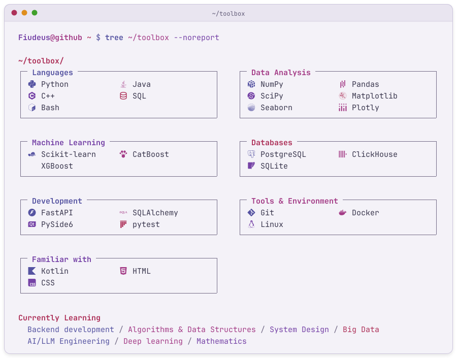

<!-- Generated by python -m scripts.generate. Edit config.toml and scripts/, then regenerate. -->

<picture>
  <source media="(max-width: 600px) and (prefers-color-scheme: dark) and (prefers-reduced-motion: reduce)" srcset="profile/session-compact-still-dark.svg">
  <source media="(max-width: 600px) and (prefers-reduced-motion: reduce)" srcset="profile/session-compact-still-light.svg">
  <source media="(prefers-color-scheme: dark) and (prefers-reduced-motion: reduce)" srcset="profile/session-still-dark.svg">
  <source media="(prefers-reduced-motion: reduce)" srcset="profile/session-still-light.svg">
  <source media="(max-width: 600px) and (prefers-color-scheme: dark)" srcset="profile/session-compact-dark.svg">
  <source media="(max-width: 600px) and (prefers-color-scheme: light)" srcset="profile/session-compact-light.svg">
  <source media="(prefers-color-scheme: dark)" srcset="profile/session-dark.svg">
  
</picture>

<picture>
  <source media="(max-width: 600px) and (prefers-color-scheme: dark)" srcset="profile/fastfetch-compact-dark.svg">
  <source media="(max-width: 600px) and (prefers-color-scheme: light)" srcset="profile/fastfetch-compact-light.svg">
  <source media="(prefers-color-scheme: dark)" srcset="profile/fastfetch-dark.svg">
  
</picture>

<picture>
  <source media="(max-width: 600px) and (prefers-color-scheme: dark)" srcset="profile/toolbox-compact-dark.svg">
  <source media="(max-width: 600px) and (prefers-color-scheme: light)" srcset="profile/toolbox-compact-light.svg">
  <source media="(prefers-color-scheme: dark)" srcset="profile/toolbox-dark.svg">
  
</picture>
