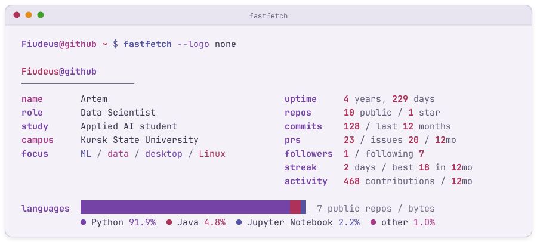

<!-- Generated by python -m scripts.generate. Edit config.toml and scripts/, then regenerate. -->

<picture>
  <source media="(max-width: 600px) and (prefers-color-scheme: dark) and (prefers-reduced-motion: reduce)" srcset="profile/session-compact-still-dark.svg">
  <source media="(max-width: 600px) and (prefers-reduced-motion: reduce)" srcset="profile/session-compact-still-light.svg">
  <source media="(prefers-color-scheme: dark) and (prefers-reduced-motion: reduce)" srcset="profile/session-still-dark.svg">
  <source media="(prefers-reduced-motion: reduce)" srcset="profile/session-still-light.svg">
  <source media="(max-width: 600px) and (prefers-color-scheme: dark)" srcset="profile/session-compact-dark.svg">
  <source media="(max-width: 600px) and (prefers-color-scheme: light)" srcset="profile/session-compact-light.svg">
  <source media="(prefers-color-scheme: dark)" srcset="profile/session-dark.svg">
  
</picture>

<picture>
  <source media="(max-width: 600px) and (prefers-color-scheme: dark)" srcset="profile/fastfetch-compact-dark.svg">
  <source media="(max-width: 600px) and (prefers-color-scheme: light)" srcset="profile/fastfetch-compact-light.svg">
  <source media="(prefers-color-scheme: dark)" srcset="profile/fastfetch-dark.svg">
  
</picture>

<picture>
  <source media="(max-width: 600px) and (prefers-color-scheme: dark)" srcset="profile/toolbox-compact-dark.svg">
  <source media="(max-width: 600px) and (prefers-color-scheme: light)" srcset="profile/toolbox-compact-light.svg">
  <source media="(prefers-color-scheme: dark)" srcset="profile/toolbox-dark.svg">
  
</picture>

<details>
<summary><samp>$ cat profile.txt</samp> — text version &amp; sources</summary>


```text
Last public activity: 2026-11-14 11:22 UTC

Fiudeus@github ~ $ cat welcome.ans

       ███████╗    ██╗    ██╗   ██╗    ██████╗     ███████╗    ██╗   ██╗    ███████╗
       ██╔════╝    ██║    ██║   ██║    ██╔══██╗    ██╔════╝    ██║   ██║    ██╔════╝
       █████╗      ██║    ██║   ██║    ██║  ██║    █████╗      ██║   ██║    ███████╗
       ██╔══╝      ██║    ██║   ██║    ██║  ██║    ██╔══╝      ██║   ██║    ╚════██║
       ██║         ██║    ╚██████╔╝    ██████╔╝    ███████╗    ╚██████╔╝    ███████║
       ╚═╝         ╚═╝     ╚═════╝     ╚═════╝     ╚══════╝     ╚═════╝     ╚══════╝

                                     Hello, I'm Artem.

Fiudeus@github ~ $ ▌

Fiudeus@github ~ $ fastfetch --logo none

Fiudeus@github
─────────────────────
name       Artem                                 uptime     4 years, 220 days
role       Data Scientist                        repos      10 public / 1 star
study      Applied AI student                    commits    unavailable
campus     Kursk State University                prs        20 / issues 12 / 12mo
focus      ML / data / desktop / Linux           followers  1 / following 7
                                                 streak     0 days / best 18 in 12mo
                                                 activity   453 contributions / 12mo

languages  ██████████████████████████████████████████  6 public repos / bytes
           ● Python 96.6%  ● Jupyter Notebook 2.3%  ● Shell 0.6%  ● other 0.5%

Fiudeus@github ~ $ tree ~/toolbox --noreport

~/toolbox/
┌─ Languages ──────────────────────────────┐    ┌─ Data Analysis ──────────────────────────┐
│    Python              Java              │    │    NumPy               Pandas            │
│    C++                 SQL               │    │    SciPy               Matplotlib        │
│    Bash                                  │    │    Seaborn             Plotly            │
└──────────────────────────────────────────┘    └──────────────────────────────────────────┘

┌─ Machine Learning ───────────────────────┐    ┌─ Databases ──────────────────────────────┐
│    Scikit-learn        CatBoost          │    │    PostgreSQL          ClickHouse        │
│    XGBoost                               │    │    SQLite                                │
└──────────────────────────────────────────┘    └──────────────────────────────────────────┘

┌─ Development ────────────────────────────┐    ┌─ Tools & Environment ────────────────────┐
│    FastAPI             SQLAlchemy        │    │    Git                 Docker            │
│    PySide6             pytest            │    │    Linux                                 │
└──────────────────────────────────────────┘    └──────────────────────────────────────────┘

┌─ Familiar with ──────────────────────────┐
│    Kotlin              HTML              │
│    CSS                                   │
└──────────────────────────────────────────┘

Currently Learning
  Backend development / Algorithms & Data Structures / System Design / Big Data
  AI/LLM Engineering / Deep learning / Mathematics
```


[Generator & local preview](docs/DEVELOPMENT.md) · [Research & project sources](docs/RESEARCH.md)


[Statistics: sources & scope](docs/STATISTICS.md) · [Raw public data](data/github.json)


Inspired by [Nyankomintsu](https://github.com/Nyankomintsu). FIGlet lettering via pyfiglet; independent SVG implementation.

</details>
